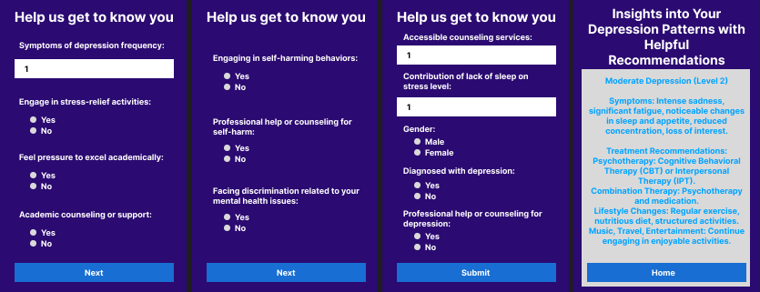

# Stress Management for Undergraduate Students (NLP & HCI)

Our undergraduate thesis project at BRAC University. We surveyed students about stress and depression, trained machine-learning models to classify their level, and built a small questionnaire app that shows a person's level with suggestions.

**Paper:** *A Data-Driven Insight to Enhancing Stress Management Through Chatbot Interaction Among Undergraduate Students*, published at the **27th International Conference on Computer and Information Technology (ICCIT 2024)**, IEEE, Cox's Bazar, Bangladesh. It won **Best Technical Presentation** of its session.

**Team:** MD Mohibur Zaman, Md. Rifat Rahman, Mehbub Shifat ur Rasul, MD Showrav Zaman, Md. Mohyminul Islam Fahim, Anika Tahsin, Sadiqul Sakif. **Supervisor:** Jannatun Noor.

  

## What we did

1. **Survey.** 30 questions on mental health and academic pressure plus a 15-question stress and depression assessment, checked with psychiatrists from the BRACU Counseling Unit. Shared on Discord and Facebook through Google Forms; 473 responses.
2. **Cleaning.** Mapped answers to numbers, handled missing values and outliers, and kept the features that correlated with the target (threshold 0.12).
3. **Models.** Trained seven classifiers on an 80/20 split to predict one of five depression levels.
4. **App.** A Flask questionnaire app that asks the questions, predicts the level and shows treatment and lifestyle suggestions (screenshot above).

## Results

| Model | Accuracy | F1-score | Precision |
|---|---|---|---|
| Decision Tree | 100% | 100% | 100% |
| Random Forest | 100% | 100% | 100% |
| Gradient Boosting | 100% | 100% | 100% |
| Logistic Regression | 97.89% | 97.88% | 98.14% |
| Naive Bayes | 96.84% | 96.89% | 97.17% |
| AdaBoost | 85.26% | 79.18% | 74.92% |
| SVM | 84.21% | 80.45% | 87.2% |

## Files

| File / folder | What it is |
|---|---|
| `Enhancing_Stress_Management_Among_the_Undergrad_Student (1).pdf` | The published ICCIT 2024 paper |
| `Enhancing_Stress_Management_Among_the_Undergrad_Student.pdf`, `T2220068_ieee_report__Copy_.pdf` | Earlier versions of the paper |
| `Pre-Thesis 2.pdf` | Pre-thesis II report (literature review, survey design, planned models) |
| `Presentation Slide.pptx` | Conference presentation |
| `Certificate.jpg` | Best Technical Presentation certificate |
| `Application/Dataset/` | Survey responses |
| `Application/Post preprocessed/` | Cleaning notebook and the cleaned dataset |
| `Application/Data Augmentation/` | Notebooks that generate extra sample rows, with their outputs as PDF |
| `Confusion Matrix/` | Confusion matrices of the models and the correlation heatmap |
| `app.png` | Screenshots of the questionnaire app |
| `Draft Research Questions.docx`, `Research Flowchart For Presentation.docx`, `Similar papers Work and paper link.docx` | Planning notes, workflow diagram and related papers |
| `Conference Management Toolkit - View review.pdf` | Reviewer feedback |
| `252.docx`, `469194468_…_n.jpg` | Registration letter and acceptance email |
| `conference_101719.tex`, `overleaf.txt` | LaTeX templates used as a starting point (not our paper) |

The notebooks were written for Google Colab and use pandas, NumPy, Matplotlib and seaborn.
